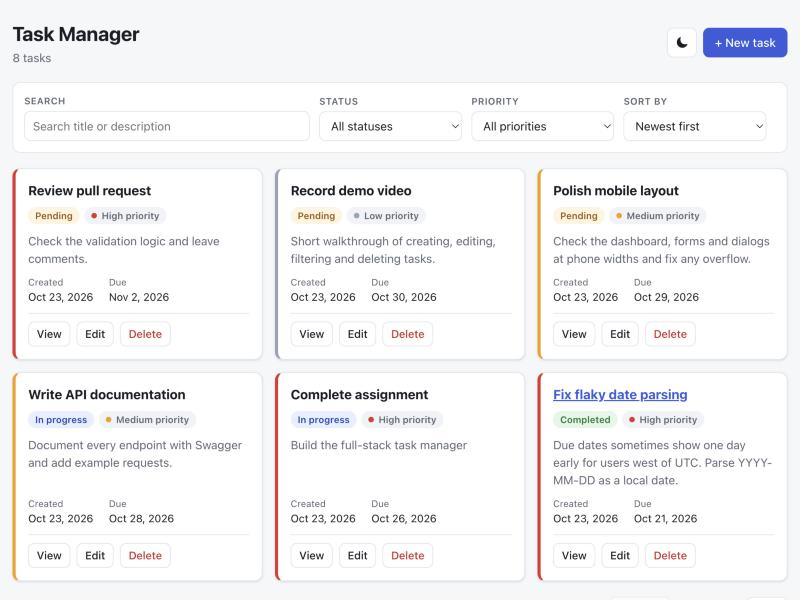
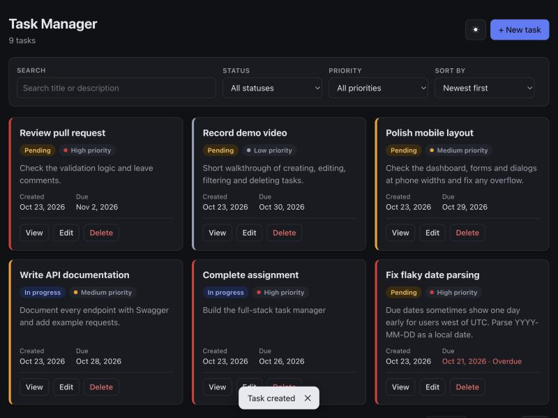
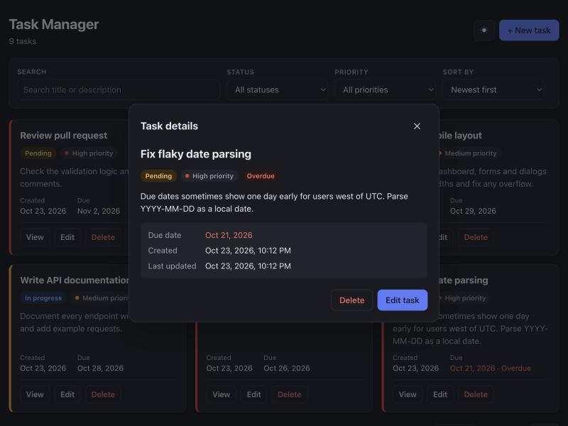
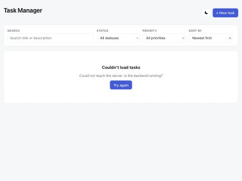
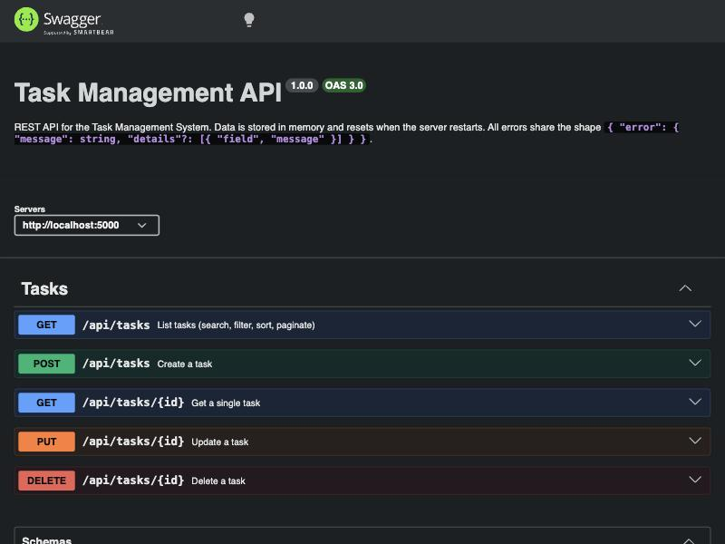
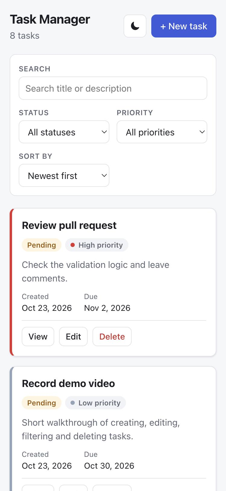
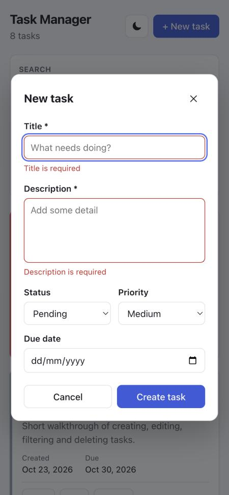

# Task Management System

A small full-stack task manager: **React (Vite)** frontend and a **Node.js + Express** REST API.
Tasks are stored **in backend memory only** — no database — so data resets when the server restarts.



## Features

- Dashboard listing tasks with title, description, status, priority, created date and due date
- Create, view (details dialog), edit and delete tasks
- Client-side validation (mirrored and enforced again on the server)
- Loading, empty, error and success states; overdue tasks are flagged
- Responsive layout for desktop and mobile
- **Bonus:** debounced search (title/description), filter by status and priority, sort by created date / priority / due date, server-side pagination, dark mode (remembers your choice, defaults to system setting), Swagger API docs

## Tech stack

| Layer    | Choice                                                   |
| -------- | -------------------------------------------------------- |
| Frontend | React 19, Vite, plain CSS (custom properties for theming) |
| Backend  | Node.js 20.12+, Express 5, `cors`, `swagger-ui-express`  |
| Storage  | In-memory array                                          |
| Tests    | Node's built-in test runner (`node --test`)              |

## Getting started

**Prerequisites:** Node.js 20.19+ or 22.12+ (Vite's minimum; the API alone runs on 20.12+). `.env` files are loaded with Node's built-in `process.loadEnvFile()`, so there's no `dotenv` dependency.

### 1. Backend

```bash
cd backend
npm install
cp .env.example .env   # optional — defaults work without it
npm run dev            # http://localhost:5000
```

### 2. Frontend (in a second terminal)

```bash
cd frontend
npm install
cp .env.example .env   # optional — defaults to http://localhost:5000
npm run dev            # http://localhost:5173
```

Open http://localhost:5173. The API starts with 8 sample tasks so pagination and filters have something to show (set `SEED_DATA=false` for an empty list).

### Other scripts

| Where     | Command         | What it does                         |
| --------- | --------------- | ------------------------------------ |
| backend   | `npm start`     | Run the API without file watching    |
| backend   | `npm test`      | Run the API integration tests        |
| frontend  | `npm run build` | Production build into `frontend/dist` |

## Environment variables

**backend/.env**

| Variable      | Default                 | Purpose                                         |
| ------------- | ----------------------- | ----------------------------------------------- |
| `PORT`        | `5000`                  | Port the API listens on                         |
| `CORS_ORIGIN` | `http://localhost:5173` | Allowed frontend origin(s), comma-separated     |
| `SEED_DATA`   | `true`                  | Load sample tasks on startup                    |

**frontend/.env**

| Variable       | Default                 | Purpose          |
| -------------- | ----------------------- | ---------------- |
| `VITE_API_URL` | `http://localhost:5000` | Backend base URL |

## API documentation

Interactive Swagger docs: **http://localhost:5000/api/docs**
Raw OpenAPI 3 spec: `http://localhost:5000/api/openapi.json` — in Postman use **Import → Link** with this URL to get a ready-made collection.

### Endpoints

| Method | Endpoint         | Purpose           | Success | Errors   |
| ------ | ---------------- | ----------------- | ------- | -------- |
| GET    | `/api/tasks`     | List tasks        | 200     | 400      |
| GET    | `/api/tasks/:id` | Get a single task | 200     | 404      |
| POST   | `/api/tasks`     | Create a task     | 201     | 400      |
| PUT    | `/api/tasks/:id` | Update a task     | 200     | 400, 404 |
| DELETE | `/api/tasks/:id` | Delete a task     | 200     | 404      |

### Task object

```json
{
  "id": "6f1c2a9e-0d8b-4a57-9a1e-3c2f8b7d4e10",
  "title": "Complete assignment",
  "description": "Build the full-stack task manager",
  "status": "pending",
  "priority": "high",
  "dueDate": "2026-10-05",
  "createdAt": "2026-10-23T10:15:00.000Z",
  "updatedAt": "2026-10-23T10:15:00.000Z"
}
```

| Field         | Rules                                                          |
| ------------- | -------------------------------------------------------------- |
| `title`       | Required, non-blank, max 100 chars                             |
| `description` | Required, non-blank, max 1000 chars                            |
| `status`      | `pending` \| `in_progress` \| `completed` (default `pending`) |
| `priority`    | `low` \| `medium` \| `high` (default `medium`)                |
| `dueDate`     | `YYYY-MM-DD` calendar date or `null`                           |

Unknown fields are ignored. On `PUT`, `title` and `description` are required; omitted optional fields keep their current values.

### List query parameters (`GET /api/tasks`)

| Param      | Values                                | Default     |
| ---------- | ------------------------------------- | ----------- |
| `search`   | Text matched against title/description (case-insensitive) | — |
| `status`   | `pending`, `in_progress`, `completed` | —           |
| `priority` | `low`, `medium`, `high`               | —           |
| `sortBy`   | `createdAt`, `priority`, `dueDate`    | `createdAt` |
| `order`    | `asc`, `desc`                         | `desc`      |
| `page`     | Integer ≥ 1                           | `1`         |
| `limit`    | Integer 1–100                         | `10`        |

Tasks without a due date are always listed last when sorting by due date.

### Response shapes

```jsonc
// GET /api/tasks
{ "data": [ /* tasks */ ], "meta": { "total": 8, "page": 1, "limit": 10, "totalPages": 1 } }

// GET/POST/PUT single task
{ "data": { /* task */ } }

// DELETE
{ "data": { /* deleted task */ }, "message": "Task deleted" }

// Any error (400, 404, 413, 500)
{ "error": { "message": "Validation failed", "details": [{ "field": "title", "message": "title is required" }] } }
```

### Example

```bash
curl -X POST http://localhost:5000/api/tasks \
  -H "Content-Type: application/json" \
  -d '{"title":"Complete assignment","description":"Build the full-stack task manager","status":"pending","priority":"high","dueDate":"2026-10-05"}'
```

## Project structure

```
backend/
├── src/
│   ├── routes/task.routes.js        # URL → middleware → controller wiring
│   ├── controllers/task.controller.js  # HTTP in/out, status codes
│   ├── services/task.service.js     # In-memory store + search/filter/sort/paginate
│   ├── middleware/validate.js       # Body and query validation
│   ├── middleware/errorHandler.js   # 404 + centralised error responses
│   ├── docs/openapi.json            # Swagger / OpenAPI 3 spec
│   ├── app.js                       # Express app factory (used by server and tests)
│   └── server.js                    # Reads env, seeds data, starts listening
└── test/tasks.test.js               # API integration tests

frontend/src/
├── api/tasks.js          # The only module that calls the backend
├── hooks/                # useTasks (fetch + abort stale requests), useDebounce, useTheme
├── components/           # Toolbar, TaskList, TaskCard, TaskForm, TaskDetails, Modal, Pagination, Toast, …
├── utils/task.js         # Options, date formatting, client validation
└── App.jsx               # Page state: filters, pagination, which dialog is open
```

## Design notes

- **Validation lives in two places on purpose.** The form validates instantly for UX; the API validates again because it can't trust clients. Server field errors are mapped back onto the matching form fields.
- **Search, filter, sort and pagination run on the server**, so the API stays usable by any client and the frontend never needs the full list.
- **Stale responses can't win.** Each list request is aborted when the query changes, so a slow response for an old search never overwrites a newer one.
- **Due dates are calendar dates** (`YYYY-MM-DD`) and are formatted in local time, avoiding the classic off-by-one-day bug from parsing them as UTC.
- **Dialogs use the native `<dialog>` element**, which provides focus trapping, Escape-to-close and a backdrop without a library.

## Screenshots

| Desktop (light) | Desktop (dark) |
| --- | --- |
|  |  |

| Task details | Error state | Swagger |
| --- | --- | --- |
|  |  |  |

| Mobile | Mobile form validation |
| --- | --- |
|  |  |
